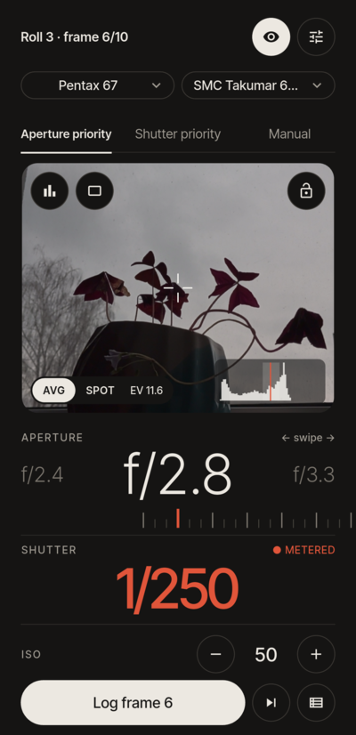
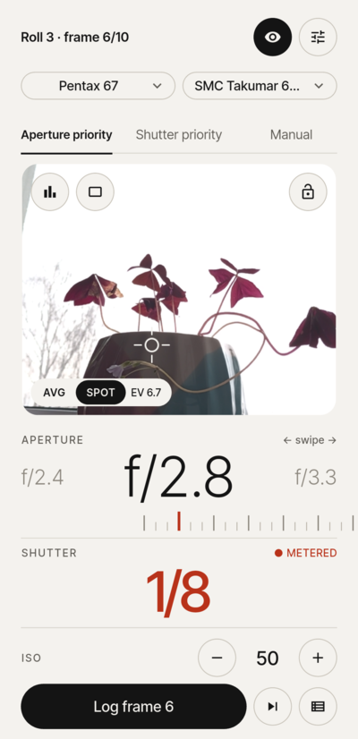
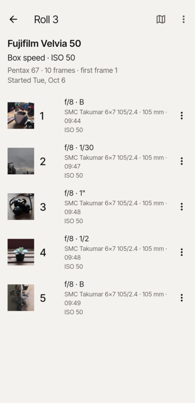
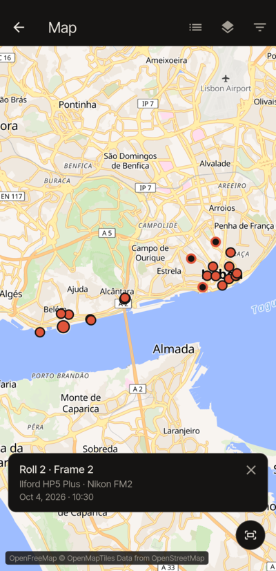
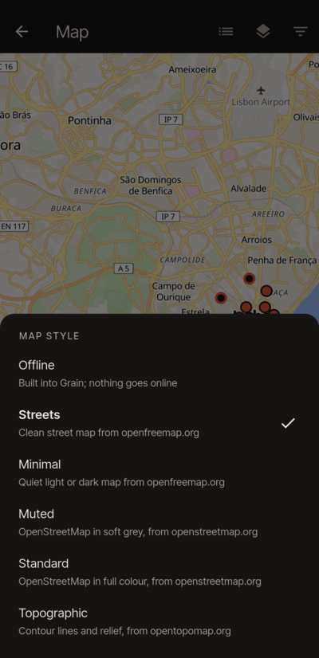
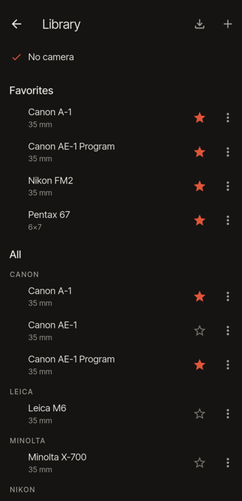

# Grain

**A light meter and roll log for film photographers, on Android.**

Grain meters with the phone camera, changes any value with one swipe, knows the
cameras and lenses you actually own, and keeps a frame-by-frame log of every
roll. Free software (GPLv3): no account, no ads, no tracking, no paywall, and
no Google Play Services.

<table align="center">
  <tr>
    <td align="center"><br><sub>Average metering, dark mode</sub></td>
    <td align="center"><br><sub>Spot metering, light mode</sub></td>
    <td align="center"><br><sub>A roll and its frames</sub></td>
  </tr>
  <tr>
    <td align="center"><br><sub>Map of logged frames</sub></td>
    <td align="center"><br><sub>Map styles, offline first</sub></td>
    <td align="center"><br><sub>Gear library</sub></td>
  </tr>
</table>

<sub>Screenshots use demo data (`tool/demo/demo_backup_test.dart`).</sub>

## Features

### Metering
- **One-swipe dials.** One value per detent, in your camera's own steps (full,
  half or third stops), with haptic ticks, a stronger one on full stops; a
  fast swipe keeps spinning and stops on a value.
- **Average or spot.** Average over what your lens sees (centre-weighted), or
  tap the preview for a spot; the AVG | SPOT switch shows which, with the EV
  right beside it.
- **Aperture priority, shutter priority, manual and free modes.** In manual,
  a match-needle scale shows how far your settings are from the meter.
- **Its own exposure loop.** Grain sets the camera's exposure itself instead of
  trusting the phone's auto-exposure, so dim scenes read true, and it adapts
  from a dark room to daylight in well under a second. Antibanding under
  artificial light.
- **Viewfinder with your lens's framing** on your camera's film format, sideways
  or upright, switching to the ultra-wide or the phone's zoom as the lens needs.
- **Histogram** of the frame with your film's latitude, and an optional
  camera-shake warning.

### Your gear
- A bundled library of bodies and lenses, plus your own profiles and
  favourites; the dials offer only what your camera and lens can set.
- Camera and lens chips: tap to cycle favourites.
- Share a profile as a QR code or a file.

### Rolls
- Start a roll with its film, ISO and push or pull, then **Log frame** with one
  tap (Undo for a moment after), or **Skip frame** for a shot taken without a
  reading.
- A small reference snapshot and, if you like, the location with each frame.
- **A camera per frame:** continue a roll in another body of the same format
  from any frame on.
- Edit, insert and delete frames; export a roll as CSV, JSON (EXIF-ready) and a
  zip of its snapshots; back up and restore everything.

### Map
- See where you logged frames and readings, drawn smoothly by MapLibre Native.
- **Offline by default:** built-in Natural Earth outlines and place names, no
  network at all.
- Optional online styles: Streets and Minimal (OpenFreeMap vector maps), Muted,
  Standard and Topographic (OpenStreetMap, OpenTopoMap).
- The same points as a list, for TalkBack and for everyone.

### Looks and privacy
- A quiet, paper-like design in light or dark, following the system.
- The meter never uses the network. The app holds the INTERNET permission only
  for the map's optional online styles and goes online only with one chosen
  (Settings > Map, or the map's layers button); with the default Offline style
  MapLibre is told there is no network and every request is refused before it
  leaves the phone. The online styles load from tiles.openfreemap.org
  (Streets, Minimal), tile.openstreetmap.org (Standard, Muted) or
  opentopomap.org (Topographic), and nothing else. No Mapbox SDK, no API key,
  no telemetry.

## Build and run from source

You need:

- Flutter 3.50.1 (stable)
- JDK 21 (the `maplibre_gl` plugin's Android side is compiled for Java 21;
  JDK 17 fails with "invalid source release: 21")
- The Android SDK (platform 36 or 37, build-tools, platform-tools and the NDK
  that `flutter doctor` asks for; Gradle installs a missing NDK itself once the
  licences are accepted)
- A C compiler on the host (SQLite is compiled from the vendored source in
  `third_party/sqlite/`, also for the host tests)

Accept the Android licences with `flutter doctor --android-licenses` and check
`flutter doctor`.

The maintainer keeps a user-space toolchain in an environment script,
`~/.grain-env.sh`. You do not have that file; write your own with the paths of
your installation, for example:

```
export JAVA_HOME="$HOME/.local/jdk-21"
export ANDROID_HOME="$HOME/Android/Sdk"
export ANDROID_SDK_ROOT="$ANDROID_HOME"
export PATH="$HOME/flutter/bin:$JAVA_HOME/bin:$ANDROID_HOME/cmdline-tools/latest/bin:$ANDROID_HOME/platform-tools:$PATH"
```

Source it in every shell (`source ~/my-grain-env.sh`), then:

```
flutter pub get
flutter run
```

## Tests

```
flutter test
flutter analyze
cd android && ./gradlew :app:testDebugUnitTest
```

`android/gradlew` is not in the repository; Flutter writes it on its first
Gradle build. On a fresh clone, run `flutter build apk --release` once before
the Gradle command.

The checks that need a real phone (camera, haptics, sharing) are listed in
`docs/testing/device-test-script.md`, one ordered session with an expected result
and a box to tick for each step; there is no automated device test.

## Release build

```
flutter build apk --release --split-per-abi
adb install build/app/outputs/flutter-apk/app-arm64-v8a-release.apk
```

Without `android/key.properties` this is debug-signed, which is fine for your
own phone. The published APKs are built in F-Droid's build environment and
signed by `tool/release/build_release.sh`, so that F-Droid can reproduce them;
the release flow, signing, versionCodes and reproducibility notes are in
[docs/release.md](docs/release.md).

## Contributing gear

Every camera body and every lens is one JSON file, in the format described by
`library/schema/gear-1.schema.json`.

- Bodies go in `library/bodies/<make>/<id>.json`, where `<make>` is the make in
  lower case with spaces replaced by `-` (for example `library/bodies/canon/canon-a1.json`).
- Lenses go in `library/lenses/<mount>/<id>.json`, where `<mount>` is the
  lens mount id (for example `library/lenses/canon-fd/canon-fd-50-1.8.json`).
- The file name is the `id` plus `.json`. Ids are unique and use only
  `a-z`, `0-9`, `.` and `-`.
- Use the manufacturer's specifications: real shutter speeds (including B or
  T), ISO range, maximum and minimum aperture and zoom breakpoints.
- Every new directory needs an entry under `flutter: assets:` in `pubspec.yaml`.
- Run `flutter test test/library` to check your files against the schema and
  the layout rules. CI runs the same check.

All files in `library/` are dedicated to the public domain under CC0 1.0, see
`library/LICENSE`. By contributing you agree to that.

## Licence

- Code: GPLv3, see [LICENSE](LICENSE).
- Gear library (`library/`): CC0 1.0, see `library/LICENSE`.
- Inter Tight font subset: SIL Open Font License, see `assets/fonts/OFL.txt`.
- SQLite (vendored in `third_party/sqlite/`): public domain.

### Third-party notices

The APK also contains code under other licences. The app shows all of these
notices under Settings > Licences.

- ZXing core 3.5.4 (`com.google.zxing:core`, QR code decoding): Apache
  License 2.0. The full text is in `assets/licenses/apache-2.0.txt`.
- The Flutter engine and framework and the pub packages (BSD, MIT and Apache
  2.0 licences): Flutter collects their notices into the build.
- Inter Tight: SIL Open Font License 1.1 (`assets/licenses/ofl-1.1.txt`).
- MapLibre Native for Android 13.7.1 (`org.maplibre.gl:android-sdk-opengl`,
  through the `maplibre_gl` plugin, itself BSD 3-Clause): BSD 2-Clause
  (`assets/licenses/maplibre-native.txt`).
- OkHttp 5 (the map's HTTP client): Apache License 2.0.
- Noto Sans Regular and Bold glyphs for the offline map's place names (from
  openmaptiles/fonts, cut to the characters used by `tool/basemap/glyphs.dart`):
  SIL Open Font License 1.1 (`assets/licenses/noto-sans.txt`).
- Natural Earth (the offline map): public domain
  (`assets/licenses/natural-earth.txt`).
- OpenFreeMap and OpenMapTiles (the Streets and Minimal styles): CC-BY 4.0,
  with OpenStreetMap data under the ODbL (`assets/licenses/openfreemap.txt`).
- SQLite: public domain (`assets/licenses/sqlite.txt`).
- The gear library: CC0 1.0 (`assets/licenses/cc0-1.0.txt`).

The source is at <https://github.com/wladiKrin/grain>.
