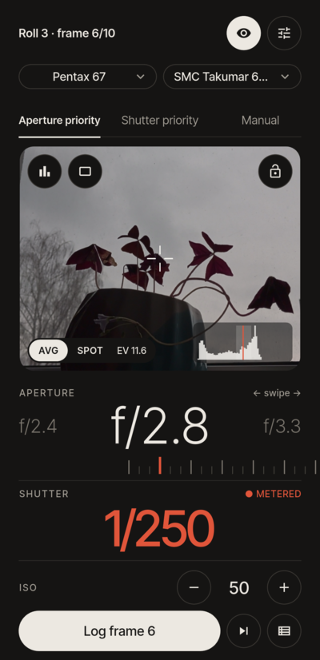
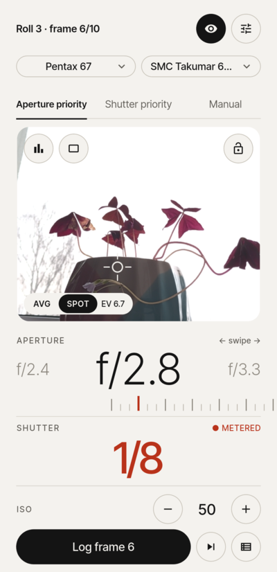
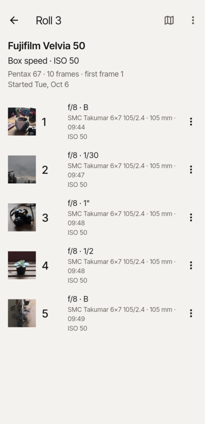
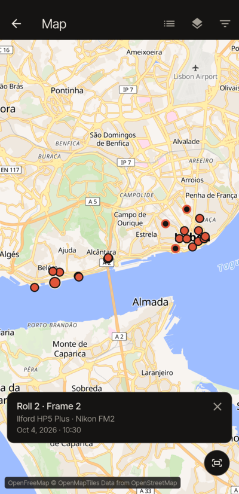
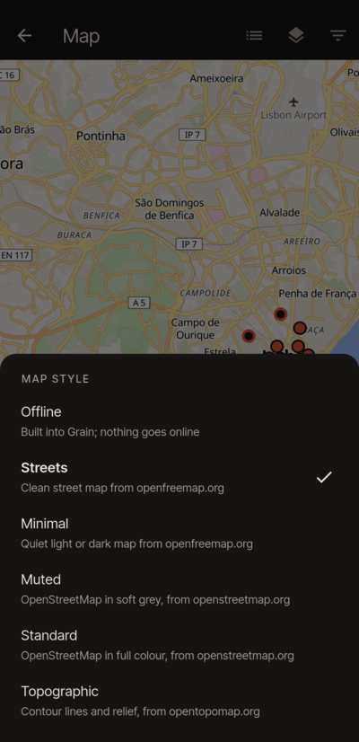
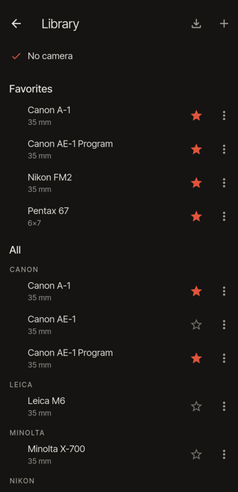

<!--
Description for the fdroiddata merge request "New app: Grain".
Filled in from fdroiddata's .gitlab/merge_request_templates/Default.md
(the "New App" template; the "Closes rfp#" line is left out, there is no
RFP issue). Paste everything below the line into the MR.
-->

---

## Abstract for new app inclusion

### Please introduce the functions and usage of your app in summary, and also attach some screenshots.

Grain is a light meter and roll log for film photographers. It meters through
the phone camera (average, centre-weighted, or spot by tapping the preview) and
gives aperture, shutter speed and ISO in aperture priority, shutter priority,
manual and free modes. Each dial moves one value per swipe detent, in the steps
the user's camera uses (full, half or third stops). A bundled library of camera
bodies and lenses (CC0) limits the dials to what the user's own gear can set.
Rolls are logged frame by frame with settings, notes, a small reference
snapshot and optionally the location; rolls export as CSV/JSON (plus a zip of
the snapshots), and all data can be backed up and restored. Logged frames can
be shown on a map drawn by MapLibre Native: a built-in offline map by default,
or an online style if the user picks one.

Screenshots (demo data):

| | | |
|---|---|---|
|  |  |  |
|  |  |  |

### Please elaborate why you wrote this app. Please highlight the unique functions it provides over other similar apps in F-Droid.

I shoot film and wanted one app that both meters and logs the roll, without an
account, ads, a paywall or Google Play Services. Compared with other light
meters on F-Droid, Grain:

- runs its own exposure loop on the camera instead of trusting the phone's
  auto-exposure, so dim scenes read true;
- knows the user's actual cameras and lenses (bundled CC0 library plus own
  profiles, shareable as QR code or file) and offers only the values they can set;
- keeps a per-frame roll log (a camera per frame, skip/insert/edit frames,
  snapshots, location) with CSV/JSON export and full backup/restore;
- shows a viewfinder crop for the film format and a histogram with the film's latitude.

## Checklist

### Policy

* [x] The app complies with the [inclusion policy](https://f-droid.org/docs/Inclusion_Policy). _Pay special attention to Quality point 6._
  GPL-3.0-only, no ads, no tracking, no Google Play Services. SQLite is built
  from the vendored amalgamation (`third_party/sqlite`, public domain) through
  the `sqlite3` package's build hook, not downloaded. MapLibre Native for
  Android (BSD-2) and OkHttp (Apache-2.0) come as FLOSS artifacts from Maven
  Central. `maplibre_gl.playServicesLocation=false` keeps
  `com.google.android.gms` out of the build; the recipe also deletes the
  plugin's Play Services source and dependency lines in `prebuild` (as other
  maplibre_gl apps here do), because the scanner reads them regardless.
  The built APKs have no `com/google/android/gms` classes.
* [x] The original app author has been notified (and does not oppose the inclusion). I am the author.
* [x] The upstream app source code repo contains the app metadata in a [Fastlane](https://gitlab.com/snippets/1895688) or [Triple-T](https://gitlab.com/snippets/1901490) folder structure. The summary and description must be included and images, icon, and changelog should also be provided for better user experience. The `en-US` locale must be included.
  `fastlane/metadata/android/en-US/`: title, short and full description,
  icon and changelog `1.txt`. Screenshots are not in the Fastlane folder at
  `v1.0.0`; they are in `docs/screenshots/` (linked above).

### Docs

* [x] Please read [the guide](https://gitlab.com/fdroid/fdroiddata/-/blob/master/CONTRIBUTING.md) first if this is your first contribution.
* [x] Please make sure your metadata follows the best practice in [our templates](https://gitlab.com/fdroid/fdroiddata/tree/master/templates).
* [x] Please read the [Build Metadata Reference](https://f-droid.org/docs/Build_Metadata_Reference/) and make sure your metadata is valid.
* [x] Please read the [Quick Start Guide](https://f-droid.org/en/docs/Submitting_to_F-Droid_Quick_Start_Guide/).

### Merge Request Setup

* [x] The title of this merge request should follow "New app: app name" format.
* [x] Please make sure your fdroiddata fork is public and your branch is not protected. See <https://docs.gitlab.com/user/project/repository/branches/protected/>.
* [x] Please read [our Git guide](https://gitlab.com/fdroid/wiki/-/wikis/Tips-for-fdroiddata-contributors/Git-Usage) if you don't know how to rebase your branch. Don't rebase your branch if there is no conflict.
* [x] All related [fdroiddata](https://gitlab.com/fdroid/fdroiddata/issues) and [RFP issues](https://gitlab.com/fdroid/rfp/issues) have been referenced in this merge request. There are none.
* [x] Please only submit one app in one MR.

### Metadata

* [x] Metadata must be put in `metadata/<applicationId>.yml`.
* [x] Metadata must be a valid YAML file.
* [x] Metadata must use LF as line ending.
* [x] Don't add summary/description/changelog/images or anything that should be provided in upstream repo. Please check the Changes tab to make sure there is no other unrelated files added in the MR.
* [x] Releases are tagged and auto update is enabled unless there is a special reason.
  Tags `v*`; `UpdateCheckData` reads `version:` from `pubspec.yaml`.
* [x] There is an issue tracker and contact info of the author so that we can report bugs and contact the author.
* [x] An AuthorName must be added. It doesn't need to be the real name.
* [x] External repos are added as git submodules instead of srclibs. You can update git submodules without opening an MR in this repo and the submodule is covered by our scanner.
  No external repos apart from the Flutter SDK, which uses the standard
  `flutter` srclib pinned to the version the app is built with (3.50.1).
* [ ] Enable [Reproducible Builds](https://f-droid.org/docs/Reproducible_Builds). We'll use your signature for improved security/reliability, also allowing users to switch between different channels. Do note that if you don't enable reproducible build then the apk will be signed with our key so you can't enable it later. If you can't enable this, please add the reasons here.
  Not for now, deliberately: please sign with the F-Droid key. The GitHub
  release APKs are built with `--obfuscate --split-debug-info`, which this
  recipe does not use, and bit-exact reproducibility against F-Droid's
  build environment has not been verified.
* [x] Setup abi split if the APK is large and the splitted ones can be much smaller.
  Three builds with `--split-per-abi`: armeabi-v7a (1001), arm64-v8a (2001),
  x86_64 (4001), the same versionCodes as the upstream release APKs
  (Flutter's `1000 * abi + build number`), mapped by `VercodeOperation`.
* [x] Only the latest versions should be kept in the metadata before it's merged. If you update the metadata, please replace the old versions with the new ones.
* [x] Don't add any disabled versions in the metadata.
* [x] The `commit` field should be the full hash. Please don't use tag or branch in commit.
  `ea8f76cd31b6df46e12abed89db74ca632597e86` (tag `v1.0.0`).

### Pipeline

* [ ] All pipelines should pass.
  (Tick once the MR pipeline is green.) Locally, in
  `registry.gitlab.com/fdroid/fdroidserver:buildserver-trixie` following this
  repo's `fdroid build` CI job, on 2026-11-26: `fdroid build` passed for
  1001, 2001 and 4001, `fdroid scanner` passed on the three APKs, and
  `fdroid lint`, `fdroid rewritemeta` (no changes) and
  `fdroid checkupdates --allow-dirty` (up to date) had no findings.
  `scanignore: assets/map/basemap.bin` is the bundled offline map, binary
  data made from public-domain Natural Earth by `tool/basemap/` in the repo.
  The remaining scanner warnings are devtools Roboto fonts inside the
  `drift` and `shared_preferences` packages in `.pub-cache`, not in the app.
* [ ] All warnings and errors in the Reports tab should be fixed or explained.
* [x] F-Droid CI runners are under GitLab's FOSS program, so there's no need for you to pay for any CI time. If Gitlab starts asking for phone numbers or credit cards don't submit anything, just leave a note in the MR so we know we need to trigger the CI.

### Anti-features

None expected. The app has no ads, no tracking, no non-free dependencies and
no non-free network services. `INTERNET` is used only for the optional online
map styles, which are off by default (the default map style is a bundled
offline map). When the user picks one, tiles come from free services:
OpenFreeMap (tiles.openfreemap.org), OpenStreetMap (tile.openstreetmap.org)
and OpenTopoMap (opentopomap.org). Permissions: `CAMERA` (metering),
`ACCESS_FINE_LOCATION`/`ACCESS_COARSE_LOCATION` (optional location per
frame), `INTERNET` (optional online map), plus AndroidX's own
`DYNAMIC_RECEIVER_NOT_EXPORTED_PERMISSION`. MapLibre's
`ACCESS_NETWORK_STATE` and `ACCESS_WIFI_STATE` are removed in the manifest.

---------------------

/label ~"New App"
